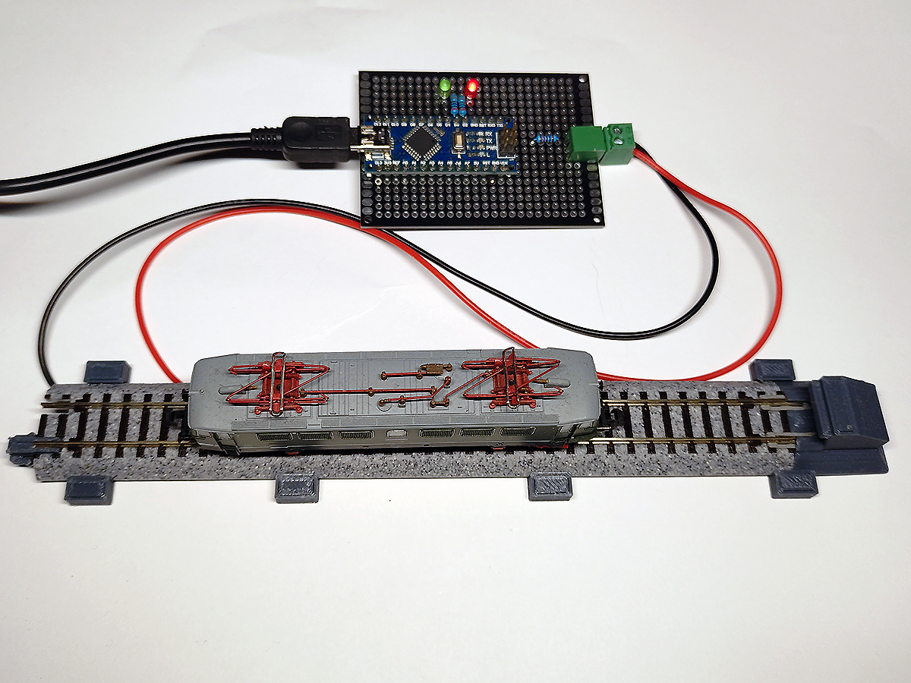
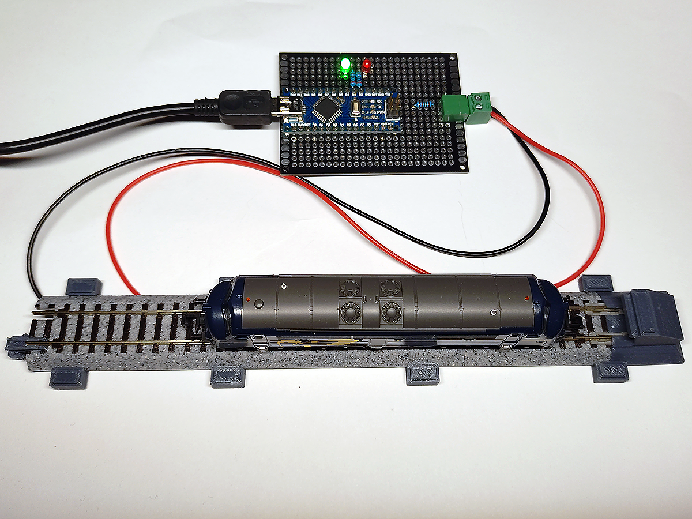
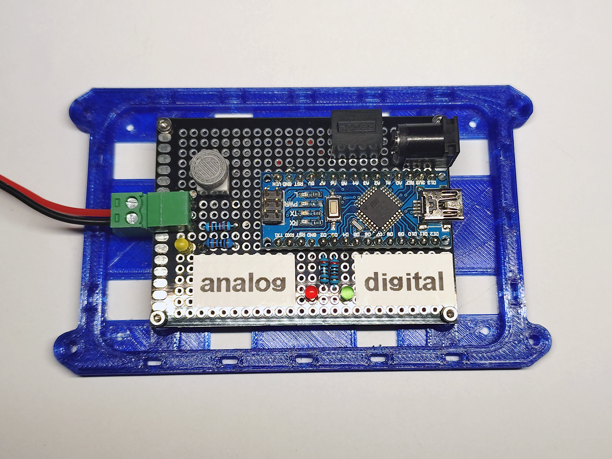

# MoBa-Detect-Digital 

Durch diesen [Thread: Ist eine Lok analog oder digital? Wie erkennen?](https://www.1zu160.net/scripte/forum/forum_show.php?id=1522193) auf [https://www.1zu160.net](1zu160.net) bin ich auf die Idee gekommen, dieses kleine Projekt aufzusetzen

Ich habe die Schaltung um einen Spannungsregler und einen Schalter mit LED Anzeige ergänzt. Damit wird das Testgleis bis zum Aufgleisen spannungsfrei geschaltet.

## Schaltung

````
  Erkennung ob ein Modell (Lok) digitalisiert ist
  Beide LEDs aus: Gleis leer
  rot leuchtet:  Anlalog
  grün leuchtet: Digital
  
  [D2] ────[ 2 kΩ ]────(>|)────[GND]   (Rote LED: Analog)
                       Anode Kathode
                      (lang) (kurz)

  [D3] ────[ 2 kΩ ]────(>|)────[GND]   (Grüne LED: Digital)
                       Anode Kathode
                      (lang) (kurz)

  [5V] ────[ 10 kΩ ]────┬──── Gleisanschluss 1 (Schiene A)
                        │
                       [A0]  (Misst die Spannung am Gleis)

  [GND] ────────────────┴──── Gleisanschluss 2 (Schiene B)
````

<a href="images/IMG_20261114_153341.885.png"></a>

<a href="images/IMG_20261114_153409.230.png"></a>

<a href="images/IMG_20261116_162519.114.png"></a>
